# Demo video storyboard (draft for Vidyut)

This is a shot-by-shot storyboard of the approved script in [docs/demo-script.md](../demo-script.md) (version A, dev-10, 2:15). Each shot has one still, the text on screen, the voice line and its length.

- **Where the stills come from:** captured on Nov 19, about 22:00 ET, at 1440 x 900 in the light theme.
  - The web shots are from https://patient-0.vercel.app.
  - The terminal shots are replays with no keys and no network calls.
  - The README shots are from the repo page on GitHub.
- **Who records:** once Vidyut approves, Rohan or Vidyut records the voiceover.
- **Voice lines:** taken word for word from the script. Lines the script marks **re-approve** are marked the same way here.

## Rules for every frame

- **Replays say so.** Every trace shows the quiet line under its claim: "Replayed from the recorded run of Nov 19, 2026 · run cost $0.145" for dev-10. The only SAMPLE on screen is S9's written Tavily 503 fixture, with its SAMPLE line in frame.
- **Sped-up waits** say "sped up" on screen.
- **Numbers:** every number on screen comes from a file in the repo.
- **Off screen:**
  - Keys never appear on screen, and `.env` is never opened.
  - No competitor names or logos. S1 blurs the chatbot's name and logo, and S8 crops off the spike table under Evaluation, which names chatbots.

## Shots

| Shot | Time (length) | Still | On screen | Voice |
|---|---|---|---|---|
| **S1** the contrast | 0:00 to 0:12 (12 s) | *Captured on the day*: a chatbot's answer to dev-10's claim, then its source link opened. | A confident chatbot answer with a source link. The click lands on a page that doesn't say it. The tool's name and logo are blurred. | "Ask a chatbot where a number comes from and it'll tell you. Click the source, though, and a lot of the time it says something else." |
| **S2** the question | 0:12 to 0:20 (8 s) | 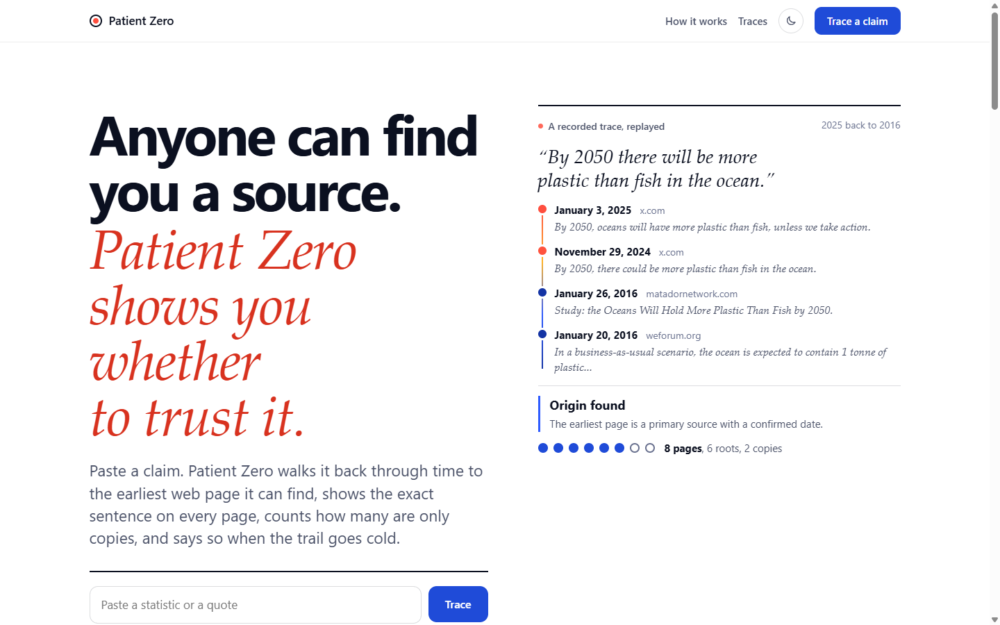 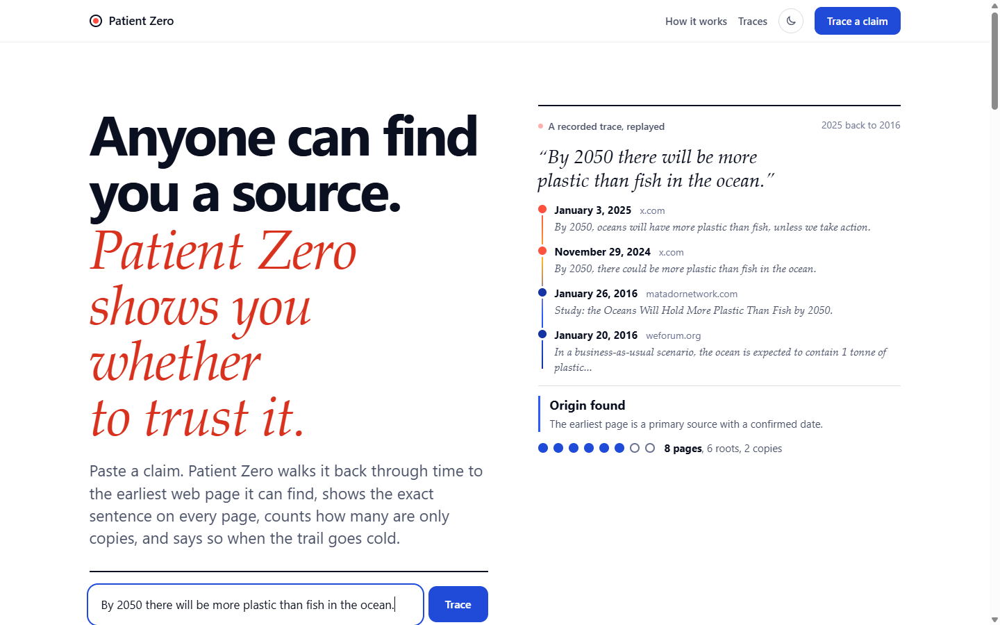 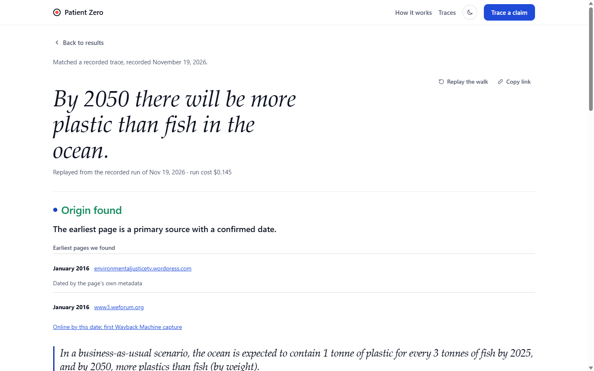 | The landing: "Anyone can find you a source. Patient Zero shows you whether to trust it.", with dev-10's recorded walk on the right ending "Origin found" and "8 pages, 6 roots, 2 copies" (**re-approve: new ending (Vidyut approved)**). Paste "By 2050 there will be more plastic than fish in the ocean." and press Enter. The trace opens with "Matched a recorded trace" and the replay line under the claim. | "So we built Patient Zero. Give it one claim, and it walks back through time to the earliest page it can find." |
| **S3** the walk | 0:20 to 0:40 (20 s) | 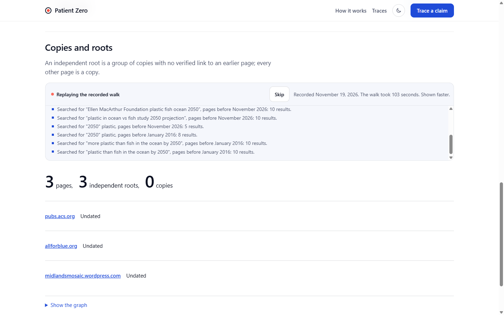 | Press "Replay the walk". In Copies and roots: "Replaying the recorded walk. Recorded November 19, 2026. The walk took 103 seconds. Shown faster." Each search scrolls by with its date window and result count while the root rows fill in. The replay runs about 8 s, so press it twice, or slow it and mark it "sped up". | "This is a recorded run, step by step. Each search reaches further back in time, and each page it reads lands in the list with its date." **re-approve** (was "...lands on the timeline...") |
| **S4** the time machine | 0:40 to 0:52 (12 s) | 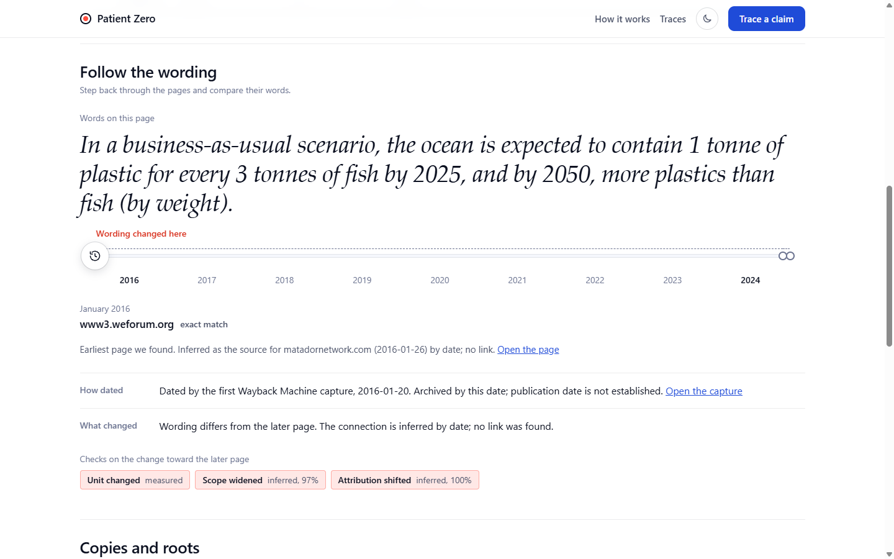  | Follow the wording: drag the slider back from x.com (January 2025) through "Wording changed here" to www3.weforum.org, January 2016, "exact match". The WEF report's own sentence is the headline. How dated: "Dated by the first Wayback Machine capture, 2016-01-20. Archived by this date; publication date is not established." | "Drag it back and you can watch the sentence change. It lands on January 2016, the earliest page it found: the World Economic Forum report, in its own words." |
| **S5** the citation | 0:52 to 1:04 (12 s) | 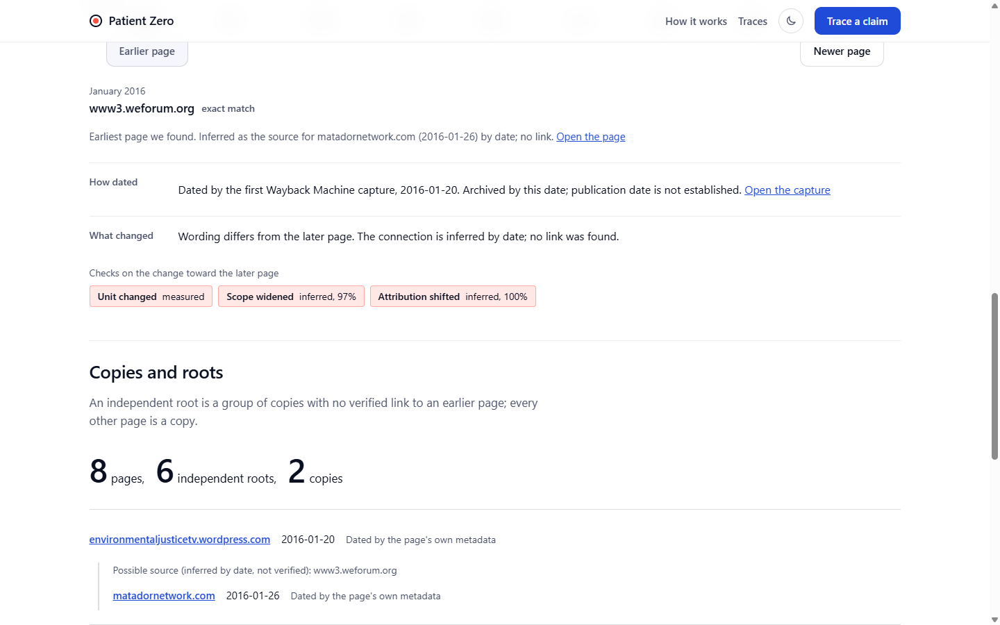 | On the WEF stop, click "Open the page". The report PDF opens, and the PDF viewer's find highlights "more plastics than fish". Optionally, "Open the capture" shows the January 20, 2016 Wayback copy. *The PDF frame is filmed on the day, because a headless browser can't show the PDF viewer.* | "Click it. The words are right there in the report: the earliest page it found, and the origin it names." **re-approve: new ending (Vidyut approved)** |
| **S6** a trail that goes cold | 1:04 to 1:16 (12 s) | 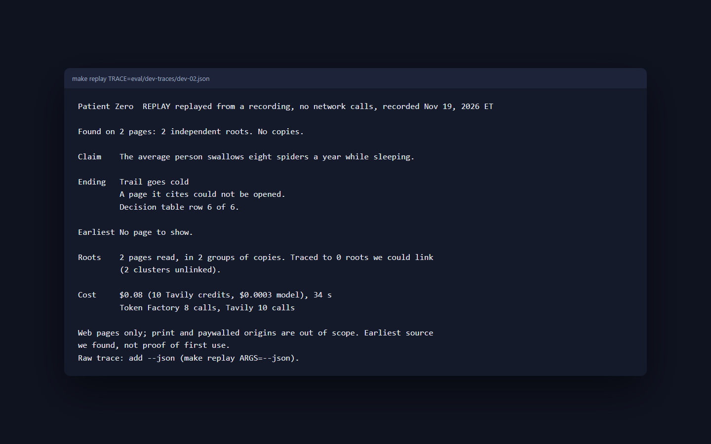 | The CLI card from `make replay TRACE=eval/dev-traces/dev-02.json`: "Trail goes cold", "A page it cites could not be opened.", "Decision table row 6 of 6." | "Sometimes there's no origin to find. It tells you that, and tells you why. The model never decides how a trace ends; the code does." |
| **S7** a whole AI answer | 1:16 to 1:30 (14 s) | 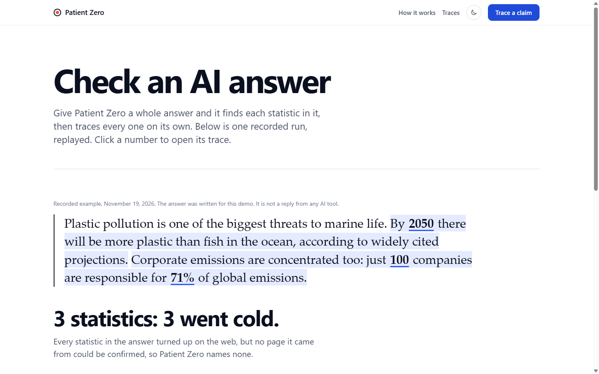 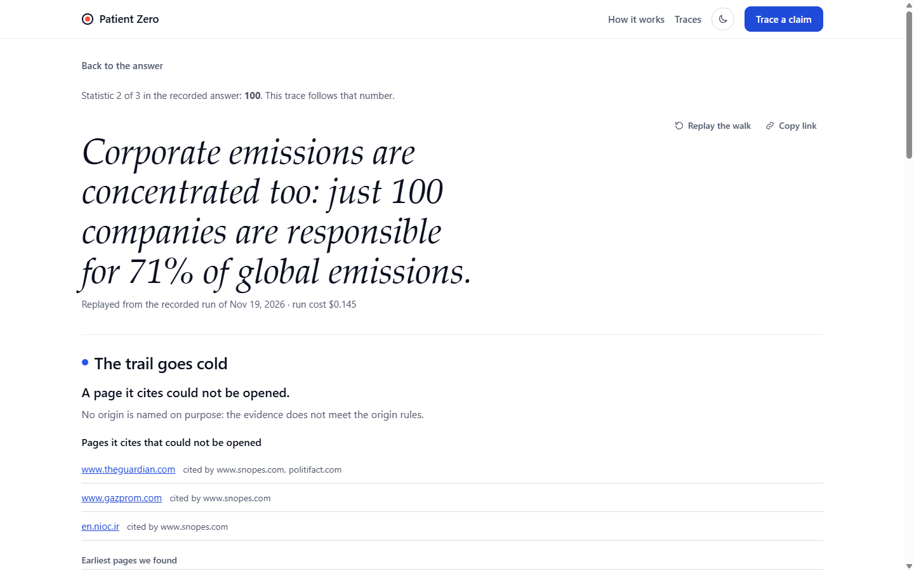 | https://patient-0.vercel.app/#/answer: the recorded answer with its statistics underlined, labelled "Recorded example, November 19, 2026. The answer was written for this demo. It is not a reply from any AI tool." and "3 statistics: 3 went cold." Click **100** to open its trace. | "You can paste a whole AI answer, too. Each statistic gets its own trace, and the code does the counting. One sentence here holds two numbers, so it's traced twice." **Note:** live answers run from the command line only (XO, #257). The page says so in frame, or the voice adds "(from the command line)". |
| **S8** the score | 1:30 to 1:45 (15 s) | 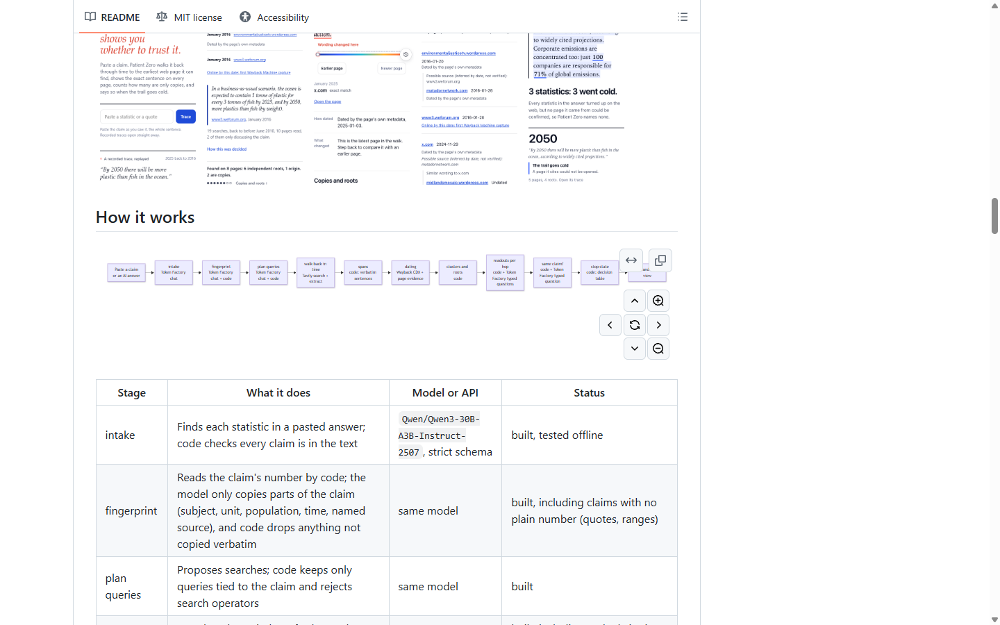 | The README Evaluation table: the E2 row (Nov 19: false origins 0, target cited 4/10, earliest 2 Pass, cold stops 6/9), then the held-out row. Crop off everything below the table. | "Before most of the engine was built, we set ten claims aside and locked them in with a hash." Then, **only after the held-out run**: "Here's how it did on them. Misses included." Until then: "On the claims we tune on, it named no false origins." |
| **S9** checking it | 1:45 to 1:55 (10 s) | 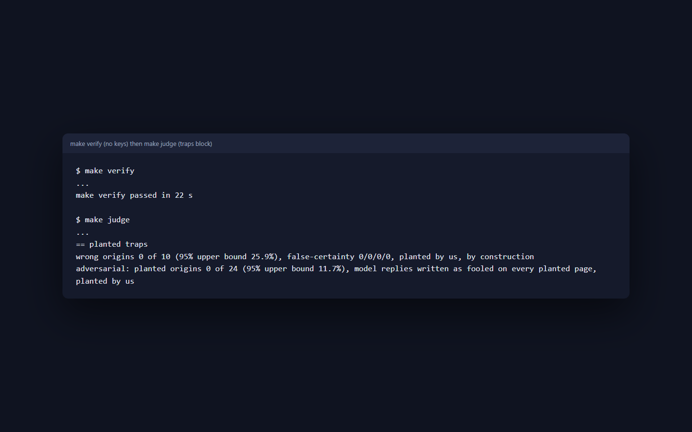 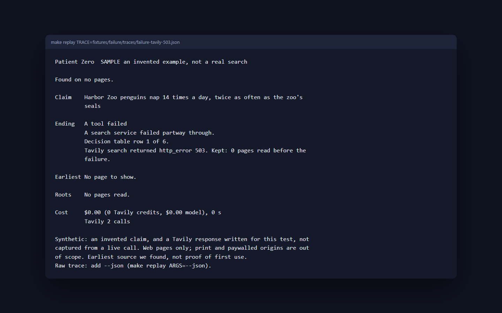 | `make verify` passes with no keys. Then crop to the "== planted traps" block of `make judge`: "wrong origins 0 of 10 ... planted by us" and "adversarial: planted origins 0 of 24 ... planted by us". Then `make replay TRACE=fixtures/failure/traces/failure-tavily-503.json` ends "A tool failed", with "SAMPLE an invented example, not a real search" in frame. | "Anyone can check every trace with one command, no keys needed. And when a search breaks, it says the search broke. It doesn't make up an answer." |
| **S10** who decides | 1:55 to 2:05 (10 s) | 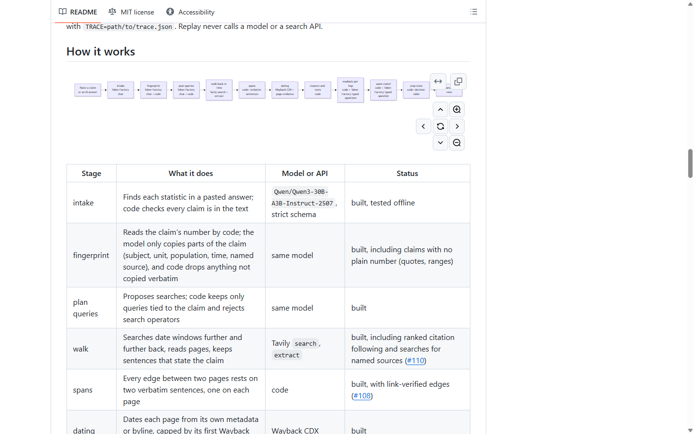 | The README "How it works" diagram, cropped to the diagram, with Token Factory and Tavily named on its boxes. GitHub renders it small, so film it with the diagram's own zoom control (the + button at its top right), two steps in, panning from "Paste a claim" to "card and trace view". | "The model answers the small questions. The code makes the call. And every link between two pages rests on a sentence quoted from each." |
| **S11** close | 2:05 to 2:15 (10 s) | 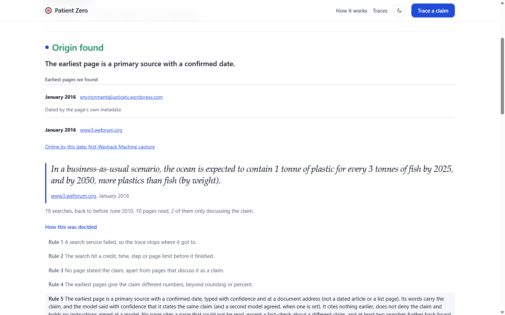 | **re-approve: new ending (Vidyut approved)**: back at the top of dev-10: "Origin found", "The earliest page is a primary source with a confirmed date.", the earliest pages (environmentaljusticetv.wordpress.com and www3.weforum.org, both January 2016) and the WEF report's own sentence. "How this was decided" is open, with Rule 5 marked "This rule decided." The cold ending stays in the video on dev-02 (S6). End card: the repo link and https://patient-0.vercel.app. | "It walked the number back to the report it came from, and every step can be checked. When the trail runs out, it says so. That's Patient Zero, from team Says Who, built on Nebius Token Factory and Tavily." **re-approve: new ending (Vidyut approved)** |

Total: 12 + 8 + 20 + 12 + 12 + 12 + 14 + 15 + 10 + 10 + 10 = 135 s (2:15).

## Open items for Vidyut

1. **Re-approve lines:** S3's voice tweak ("lands in the list"), plus the screen descriptions the script marks re-approve.
2. **New ending (#310):** dev-10 now ends "Origin found" on the WEF report, January 2016. S2, S5 and S11 are rewritten for it, with new voice lines for S5 and S11, marked "re-approve: new ending (Vidyut approved)". The stills S2a, S2c, S3, S4b and S11 are re-captured from the live site after the change.
3. **S7 voice:** keep "paste a whole AI answer" with the page's "command line only" note in frame, or add "(from the command line)" to the voice?
4. **S8:** the held-out line is "pending" in the README until Rohan's held-out run lands. Use the fallback voice line until then.
5. **S1 and S5** are filmed on the day: the chatbot capture, and the WEF PDF in a real browser.
