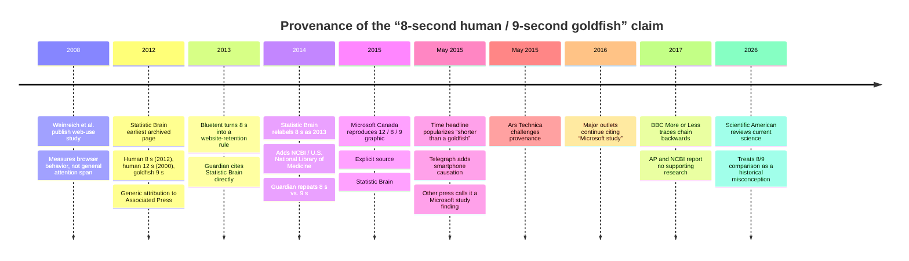

# chatgpt / claim 1

* Tool and mode: GPT 6 with high thinking, Deep Research (as shown on page)
* Date and time started (PT): Nov 1, 5:00 PM PT
* Minutes until the full answer: approx. 3–4
* Clarifying question asked by the tool: none
* Share link: https://chatgpt.com/share/6ae80193-34fc-83e9-b2f9-ced66def46c3

## Cited URLs (every one, in the order the answer lists them)

* https://www.scientificamerican.com/article/are-attention-spans-really-shrinking-what-the-science-says/
* https://www.bbc.com/news/health-38896790
* https://www.theguardian.com/commentisfree/2016/may/17/hillary-clinton-policy-donald-trump-attention-span
* https://www.nytimes.com/2016/01/22/opinion/the-eight-second-attention-span.html
* https://www.theguardian.com/higher-education-network/2015/nov/17/will-they-switch-off-game-of-thrones-for-this-the-art-of-alumni-communication
* https://arstechnica.com/science/2015/05/no-smartphones-are-not-reducing-your-attention-span-to-less-than-a-goldfishs/
* https://www.telegraph.co.uk/science/2016/03/12/humans-have-shorter-attention-span-than-goldfish-thanks-to-smart/
* https://time.com/3858309/attention-spans-goldfish/
* https://www.belfasttelegraph.co.uk/business/technology/human-attention-span-is-now-less-than-that-of-a-goldfish-microsoft-study-finds/a/118247232.html
* https://web.archive.org/web/20150528104806/http://advertising.microsoft.com:80/en/WWDocs/User/display/cl/researchreport/31966/en/microsoft-attention-spans-research-report.pdf
* https://campaignme.com/digital-essays-2014-keeping-pace-attention-race/
* https://www.theguardian.com/commentisfree/2014/aug/19/satire-tag-internet-killing-facebook-tag
* https://www.theguardian.com/technology/blog/2013/jun/24/circa-iphone-app-news
* https://www.bluetent.com/blog/8-seconds-impress-web-visitors-turning-goldfish-2/
* https://web.archive.org/web/20120208152927/http://www.statisticbrain.com/attention-span-statistics

## Full answer (pasted verbatim)
# The “8-Second Human Attention Span vs. 9-Second Goldfish” Claim: A Provenance Audit

## Executive summary

The claim that “the average human attention span is 8 seconds, shorter than a goldfish’s 9 seconds” does **not** trace to a study that measured either quantity. The earliest source I could verify is a **Statistic Brain “Attention Span Statistics” webpage captured by the Internet Archive on February 8, 2012**. That page listed “8 seconds” for the human attention span in 2012, “12 seconds” in 2000, and “9 seconds” for “a gold fish.” It credited **The Associated Press**, but supplied no article, author, study, population, method, or publication date. A later version added the U.S. National Library of Medicine/National Center for Biotechnology Information (NCBI) as a source. When the BBC’s *More or Less* contacted both AP and NCBI in 2017, **neither organization could find any research supporting the figures**. citeturn528006search0turn634279view0

Microsoft Canada did not originate the numbers and did not measure an eight-second attention span. Its Spring 2015 marketing report reproduced the three figures on page 6 under the heading “We know human attention is dwindling,” explicitly crediting “Source: Statistic brain.” Microsoft’s actual work involved an online survey/game battery of 2,000 Canadians and an EEG study of 112 Canadians, assessing sustained, selective, and alternating attention; nowhere does its methodology produce an overall human attention span measured in seconds. Indeed, the report explicitly says attention cannot be characterized simply by “how long people can concentrate.” citeturn630835view0turn896613view0turn896613view1

The numbers became globally famous in May 2015 because news organizations transformed Microsoft’s unattributed introductory graphic into the result of a “Microsoft study.” *Time*’s May 14 headline, “You Now Have a Shorter Attention Span Than a Goldfish,” was especially influential; the *Telegraph*, National Post, USA Today and others used similar formulations. The wording thereby changed in an important way: **Statistic Brain merely presented numbers; Microsoft presented them as background statistics; journalists frequently recast them as findings of Microsoft’s research and, in some cases, added causal language blaming smartphones.** citeturn238664search0turn238664search1turn238664search4

There are therefore **zero independent empirical sources supporting the exact proposition** “average human attention span = 8 seconds; average goldfish attention span = 9 seconds.” Statistic Brain is one unsupported origin node, not empirical evidence. Microsoft is a repeater of that node, not an independent measurement. The 2008 web-use study sometimes associated with Statistic Brain measured **web-page dwell behavior among 25 users**, not a species-wide “attention span,” and contains no goldfish measurement. Goldfish experiments, meanwhile, demonstrate learning and memory over intervals ranging from days to weeks, but do not establish a single “goldfish attention span” at all. citeturn868110search0turn868110search2turn868110search3

**Bottom-line provenance chain:** unsupported Statistic Brain webpage → Microsoft Canada background infographic → mass-media characterization as a Microsoft scientific finding → repeated cultural “fact.” The earliest verified popularizer I found before Microsoft is not Microsoft but Statistic Brain itself, followed by web-marketing and media repetitions from 2013 onward. No primary study, report, or press release has been identified that originated the 8/9-second measurements. citeturn649585search0turn736538search7turn528006search0

## Provenance chain, newest to oldest

The table separates the **core source chain** from important dissemination/fact-check nodes. “Publish date” means the page’s stated date where known; for Statistic Brain, the first date is an **Internet Archive capture date**, because I found no defensible original publication timestamp. Quotes are kept short to preserve exact wording while avoiding excessive reproduction.

| Source title | URL | Publish date | Exact quoted wording about the claim | Cited source(s) | What changed from the older source |
|---|---|---:|---|---|---|
| **Are attention spans really shrinking? What the science says** — *Scientific American* | https://www.scientificamerican.com/article/are-attention-spans-really-shrinking-what-the-science-says/ | 2026 | “the average human attention span had fallen from 12 seconds in 2000 to 8 seconds in 2013” | Microsoft Canada report; contemporary attention research | Treats the 8/9 claim historically and distinguishes it from modern screen-switching research rather than endorsing it. citeturn564129search6 |
| **Busting the attention span myth** — Simon Maybin, BBC *More or Less* | https://www.bbc.com/news/health-38896790 | Mar. 10, 2017 | “the average attention span is down from 12 seconds… to eight seconds… less than… nine-second… goldfish” | Time, Telegraph, Guardian, USA Today, NYT, National Post → Microsoft → Statistic Brain → AP/NCBI | First major documented backwards audit: explicitly discovers that Microsoft did **not** generate the figure and that AP/NCBI cannot locate supporting research. citeturn634279view0turn236401view1 |
| **Can Hillary Clinton convince in the age of the goldfish?** — *The Guardian* | https://www.theguardian.com/commentisfree/2016/may/17/hillary-clinton-policy-donald-trump-attention-span | May 17, 2016 | “the human attention span has fallen to eight seconds, shorter than a goldfish” | “a recent Microsoft study” | Converts Microsoft’s borrowed background statistic into a direct Microsoft “study” conclusion. citeturn736538search8 |
| **The Eight-Second Attention Span** — Timothy Egan, *New York Times* | https://www.nytimes.com/2016/01/22/opinion/the-eight-second-attention-span.html | Jan. 22, 2016 | Title: “The Eight-Second Attention Span” | Microsoft-era statistic; cited in later research/reference lists | Further normalizes “eight-second attention span” as a standalone accepted quantity. The accessible bibliographic trail confirms the article/date, but the full page was inaccessible to the crawler, so I do not attribute additional verbatim wording here. citeturn238664search5turn238664search7 |
| **‘Will they switch off Game of Thrones for this?’** — *The Guardian* | https://www.theguardian.com/higher-education-network/2015/nov/17/will-they-switch-off-game-of-thrones-for-this-the-art-of-alumni-communication | Nov. 17, 2015 | “the average human attention span has fallen from 12 seconds… to eight seconds” | Microsoft PDF | Calls the Microsoft report a “study” and states “We now have shorter attention spans than goldfish,” removing Statistic Brain from view. citeturn736538search3 |
| **No, smartphones are not reducing your attention span to less than a goldfish’s** — Ars Technica | https://arstechnica.com/science/2015/05/no-smartphones-are-not-reducing-your-attention-span-to-less-than-a-goldfishs/ | May 20, 2015 | “in 2000… 12 seconds. Now, it’s just eight seconds” | Time; Telegraph; Microsoft; Statistic Brain; web-use study | Early corrective: notices that the goldfish statistic is not Microsoft’s finding and that the linked web-use evidence does not measure general attention span. citeturn238664search0 |
| **Humans Have Shorter Attention Span than Goldfish, Thanks to Smartphones** — *The Telegraph* | https://www.telegraph.co.uk/science/2016/03/12/humans-have-shorter-attention-span-than-goldfish-thanks-to-smart/ | May 15, 2015 originally* | Headline: “Humans Have Shorter Attention Span than Goldfish, Thanks to Smartphones” | Microsoft report | Adds a **causal attribution** — smartphones — that the underlying 8/9 figures themselves did not establish. Ars quotes its body as saying smartphones left humans unable to hold attention as long as fish. citeturn238664search9turn238664search0 |
| **You Now Have a Shorter Attention Span Than a Goldfish** — Kevin McSpadden, *Time* | https://time.com/3858309/attention-spans-goldfish/ | May 14, 2015 | Headline: “You Now Have a Shorter Attention Span Than a Goldfish” | Microsoft Canada | Major popularization step: turns the comparison into a categorical second-person headline and frames it as coming from “a new study from Microsoft Corp.” citeturn238664search1turn238664search2 |
| **Human attention span is now less than that of a goldfish, Microsoft study finds** — *Belfast Telegraph* | https://www.belfasttelegraph.co.uk/business/technology/human-attention-span-is-now-less-than-that-of-a-goldfish-microsoft-study-finds/a/118247232.html | May 13, 2015 | Headline: “Human attention span is now less than that of a goldfish, Microsoft study finds” | Microsoft | Explicitly promotes an externally sourced Microsoft graphic into a finding of “Microsoft study.” citeturn238664search4 |
| **Attention spans** — Consumer Insights, Microsoft Canada | Original archived PDF: https://web.archive.org/web/20150528104806/http://advertising.microsoft.com:80/en/WWDocs/User/display/cl/researchreport/31966/en/microsoft-attention-spans-research-report.pdf | Spring 2015 | “12 seconds… 2000”; “8 seconds… 2013”; “9 seconds… goldfish” | “Source: Statistic brain” | Changes Statistic Brain’s earlier “2012” human label to **2013**, while preserving 8 seconds and 9 seconds. Places the figures beside real Microsoft research, creating an easy basis for later misattribution. citeturn896613view0turn528006search1 |
| **Statistic Brain, Attention Span Statistics** — later archived version | Archived May 4, 2015; URL noted in source trail | May 4, 2015 capture | “8.25 seconds” for 2015; “12 seconds” for 2000; “9 seconds” for goldfish | NCBI/U.S. National Library of Medicine/AP listed generically | The 8-second value becomes **8.25**, and the reference year becomes 2015; still no identifiable study. Microsoft apparently used an earlier 8-second/2013 snapshot rather than this newest version. citeturn528006search0 |
| **Digital Essay: Keeping pace with the digital race** | https://campaignme.com/digital-essays-2014-keeping-pace-attention-race/ | 2014 | “By 2013, it reduced to 8 seconds. The attention span of a goldfish is 9 seconds.” | Attributed to NCBI | Shows pre-Microsoft circulation of the 8/9 pairing and illustrates how Statistic Brain’s vague NCBI attribution was already being laundered into an authoritative biomedical citation. citeturn564129search4 |
| **Satire is dying because the internet is killing it** — *The Guardian* | https://www.theguardian.com/commentisfree/2014/aug/19/satire-tag-internet-killing-facebook-tag | Aug. 19, 2014 | “average American attention span… eight seconds… less than… a goldfish (nine seconds)” | Not clearly exposed in article text | Narrows “human” to **American**, treats the numbers as factual, and gives the comparison explanatory force. It predates Microsoft. citeturn736538search2 |
| **The Circa iPhone app: news exclusively for mobile** — *The Guardian* / Monday Note | https://www.theguardian.com/technology/blog/2013/jun/24/circa-iphone-app-news | Jun. 24, 2013 | “9 seconds for a goldfish, 8 seconds for a human in 2012” | Explicitly “according to Statistic Brain” | Early direct media repetition preserving Statistic Brain’s original **2012** year label. citeturn736538search7 |
| **8 Seconds To Impress: Why Web Visitors Are Turning Into Goldfish** — Bluetent | https://www.bluetent.com/blog/8-seconds-impress-web-visitors-turning-goldfish-2/ | Apr. 26, 2013 | “The average attention span of a Human is approximately 8 seconds” | Statistic Brain; AP | Changes “attention span” into a web-marketing rule: visitors supposedly give a site about eight seconds before leaving; it also rounds the goldfish figure to “approximately 8 seconds.” citeturn649585search0 |
| **Statistic Brain, Attention Span Statistics** — earliest verified capture | https://web.archive.org/web/20120208152927/http://www.statisticbrain.com/attention-span-statistics | Feb. 8, 2012 **capture** | “average attention span in 2012: 8 seconds”; goldfish: “9 seconds” | The Associated Press, generically | **Earliest verified node found.** No study title, author, sample, method, DOI, or AP story is supplied. This is the first retrievable source I found containing the complete 12/8/9 package. citeturn528006search0turn528006search1 |
| **The Associated Press / NCBI** | No specific underlying item identifiable | Unknown | No traceable wording identified | — | The chain terminates. BBC contacted both listed organizations; neither could find research backing the numbers. NCBI was added only on later Statistic Brain versions. citeturn236401view1 |

\*The Telegraph URL now contains a 2016 path, while bibliographic references and contemporaneous reporting give an original publication date of **May 15, 2015**. I therefore treat May 15, 2015 as the publication date and the current URL as a later migration. citeturn238664search9

The critical point in this table is that the provenance is **not** “scientific paper → Microsoft → press.” It is “statistics website of unknown provenance → Microsoft background graphic → press stories presented as Microsoft research.” BBC’s 2017 reconstruction independently reached exactly that conclusion. citeturn634279view0turn236401view1

## How the wording mutated

The earliest retrievable formulation is essentially a **bare statistical table**. Statistic Brain did not, in the surviving 2012 wording, provide an experimental description or make a strongly causal smartphone claim; it simply juxtaposed 12 seconds in 2000, 8 seconds in 2012, and 9 seconds for a goldfish. Its generic “Associated Press” attribution lent apparent authority without giving readers a traceable source. citeturn528006search0

By 2013, two mutations were already visible. First, outlets such as the *Guardian* explicitly repeated “9 seconds for a goldfish, 8 seconds for a human,” citing Statistic Brain. Second, marketers such as Bluetent converted the general statistic into a **website-retention rule**, claiming that a visitor gives a site eight seconds before leaving. That is a different empirical proposition: browser dwell time is not a general cognitive attention limit. citeturn736538search7turn649585search0

Between late 2013 and early 2014, Statistic Brain silently changed the year paired with “8 seconds” from **2012 to 2013** and added the National Center for Biotechnology Information/U.S. National Library of Medicine to its source line; there is no corresponding new study identified. By May 2015 it changed the human figure again, to **8.25 seconds for 2015**. These mutations are particularly revealing because the supposed measured quantity changes its reference year while remaining essentially the same, without a published method explaining how it was updated. citeturn528006search0

Microsoft selected the earlier **8-second/2013** form, placed it in a polished report beside genuine survey and EEG research, and labeled the graphic only “Source: Statistic brain.” The report’s own methodological framework actually cuts against the notion of a single universal attention duration: Microsoft states that attention should be broken into sustained, selective, and alternating forms because it cannot simply be characterized by how long someone concentrates. citeturn630835view0

The decisive rhetorical transformation occurred in news coverage. *Time* converted the juxtaposition into “You now have a shorter attention span than a goldfish.” The Telegraph added a causal story — “Thanks to Smartphones.” Other publications said a “Microsoft study finds” or that Microsoft “found” the decline. Thus, a source label at the bottom of an introductory infographic disappeared, and **borrowed numbers became reported experimental results**. citeturn238664search0turn238664search1turn238664search4

Later repetition made the provenance still less visible. A 2016 Guardian column said the human attention span “has fallen to eight seconds, shorter than a goldfish, according to a recent Microsoft study”; a 2017 Guardian book review similarly said “Microsoft Canada found” the 12-to-8 decline. This is a textbook example of **citation laundering**: each handoff increased the perceived authority of the numbers while moving farther from the only retrievable origin. citeturn736538search8turn736538search1

## Evidence audit: how many independent sources actually support it?

For the **exact claim**—a species-wide average human attention span of eight seconds and a goldfish average of nine seconds—the number of independent empirical supporting sources I can identify is:

**0.**

That conclusion follows from four separate checks. First, the earliest source, Statistic Brain, provides no identifiable empirical study. Second, BBC contacted its named authorities, AP and NCBI/National Library of Medicine, and neither could locate research supporting the numbers. Third, Microsoft explicitly sourced the numbers to Statistic Brain rather than to its own experiments. Fourth, no goldfish study establishing a nine-second “attention span” is identified anywhere in the trace. citeturn236401view1turn896613view0

Microsoft’s 2,000-person behavioral survey and 112-person EEG project **are independent empirical work**, but they do **not** independently support the 8-second number. Its behavioral participants were classified into relative low/medium/high attention groups; its EEG component measured attention bursts and related task responses. The report defines sustained attention as maintaining prolonged focus during repetitive activity, and says age itself was not significantly tied to sustained attention. No procedure is described that takes a representative human sample, measures “attention span,” and produces a population mean of eight seconds. citeturn630835view0

There is one real empirical study adjacent to Statistic Brain’s page that has sometimes been proposed as the origin: Harald Weinreich and colleagues’ 2008 ACM paper, *Not Quite the Average: An Empirical Study of Web Use*. It instrumented the browsers of **25 participants** and studied naturalistic web behavior. Jakob Nielsen subsequently analyzed 59,573 page views from those data. This research concerns how long users remain on webpages and how they browse; it is not a measurement of a general human attentional capacity and contains no comparison with fish. Treating web-page dwell time as “attention span” is therefore a category error. citeturn868110search0turn868110search1

The same problem applies to the goldfish half of the claim. Real goldfish research has demonstrated learning and retention over much longer intervals. In a 1994 experiment, eight goldfish learned an operant feeding schedule in which reinforcement was available for one hour per day over four weeks and showed anticipatory temporal discrimination. In a 1970 *Science* experiment, goldfish retention was tested **one day and two weeks** after learning color discriminations. Neither paper measures a generic “attention span,” but both make the folk image of a cognitively reset-every-few-seconds goldfish implausible. citeturn868110search2turn868110search3

The BBC’s interviews reinforce the conceptual problem. Open University psychologist Gemma Briggs told *More or Less* that an “average attention span” is essentially not a meaningful single psychological quantity because attention is highly task-dependent. Fish-behavior specialist Felicity Huntingford likewise emphasized that goldfish have long been used as model organisms for studying learning and memory. citeturn634279view0turn236401view2

A useful evidence classification is therefore: **0 independent empirical confirmations of the exact 8/9 claim; 1 unsupported originating webpage; many dependent repetitions; several independent empirical studies measuring other constructs that cannot validate the claim.** Any count of articles repeating the number would measure propagation, not corroboration. A recent systematic web audit even found dozens of academic papers repeating variants of the statistic, which demonstrates how far the citation error propagated rather than providing independent evidence for it. citeturn313869search0

## Timeline of the key nodes

The important chronology is that the claim was already in circulation **at least three years before** Microsoft’s report, and media outlets were repeating it directly from Statistic Brain by 2013–2014. Microsoft therefore deserves credit for amplifying the statistic, not for originating it. citeturn649585search0turn736538search7turn528006search0

## Earliest source, archival record, and remaining uncertainties

The earliest primary *document* I can verify containing the complete numerical package is the February 8, 2012 Internet Archive capture of Statistic Brain:

`https://web.archive.org/web/20120208152927/http://www.statisticbrain.com/attention-span-statistics`

That page is **not a primary scientific source**. It is an aggregator. I found no peer-reviewed paper, technical report, government dataset, institutional report, or press release preceding it that reports both the eight-second human value and nine-second goldfish value. The page’s reference to AP cannot be resolved to an AP story, and the later addition of NCBI likewise does not resolve to an NCBI-hosted study. BBC’s direct inquiries to those organizations reached the same dead end. citeturn528006search1turn236401view1

The archived Microsoft report is:

`https://web.archive.org/web/20150528104806/http://advertising.microsoft.com:80/en/WWDocs/User/display/cl/researchreport/31966/en/microsoft-attention-spans-research-report.pdf`

On page 6, the three bubbles explicitly say 12 seconds/2000, 8 seconds/2013 and 9 seconds/goldfish, with “Source: Statistic brain” at the bottom. Its methodology section, by contrast, describes the 2,000-person online survey and 112-person EEG study and does not derive those headline seconds. citeturn896613view0turn630835view0

There is a plausible but **unsupported** route by which the human number became entangled with web-use statistics: Statistic Brain also carried data related to short webpage visits, and the real 2008 Weinreich/Nielsen data showed very rapid browsing. Ars Technica suggested that this may be the statistical neighborhood from which the “eight seconds” acquired an aura of plausibility. But there is no documentary evidence that the authors of the 2008 study calculated an eight-second general attention span, and therefore I do **not** treat that paper as an origin source. citeturn238664search0turn868110search0

I also do not treat the old folk claim that goldfish have a “three-second memory” as a demonstrated precursor to the nine-second figure. The cultural association clearly predates Statistic Brain, but I found no source showing an evidentiary transformation from “three-second memory” into “nine-second attention span.” The latter should therefore be regarded as independently untraced unless a still-earlier document emerges. citeturn528006search3

My date assumption for Statistic Brain is deliberately conservative: **February 8, 2012 is the earliest archived copy located, not necessarily the date the page was first published.** The true page could have existed earlier. Similarly, the absence of a discoverable AP item cannot prove that no such item ever existed; what can be said is that neither this search nor the BBC’s direct inquiry found it, and AP itself could not identify supporting research in 2017. citeturn236401view1turn528006search0

The most defensible final characterization is therefore: **the 8-second/9-second comparison is an orphan statistic whose earliest retrievable appearance is a 2012 statistics-aggregation webpage; Microsoft Canada amplified it in 2015 without claiming it as its own measurement; news coverage then repeatedly misattributed it to Microsoft’s research. There is no identified empirical primary source for either number, and the count of independent empirical sources supporting the exact claim is zero.** citeturn896613view0turn236401view1turn868110search0
