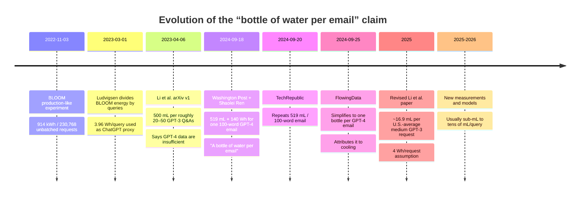
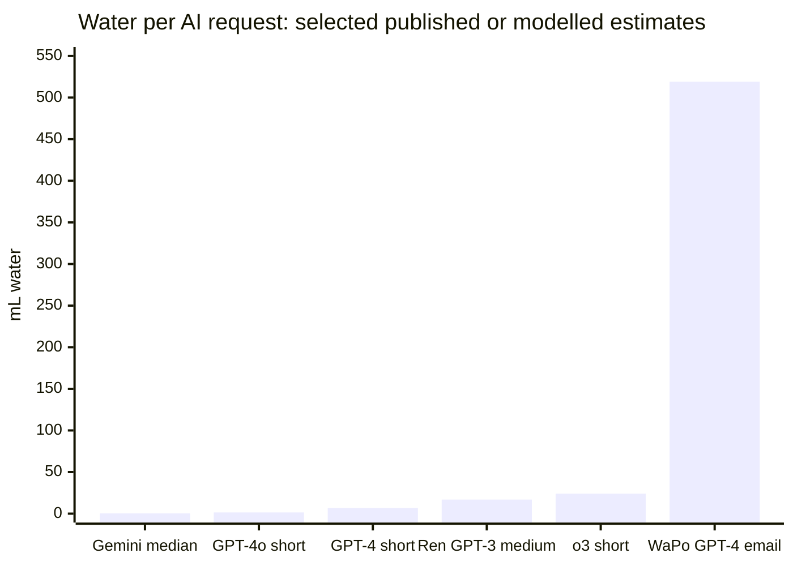

# chatgpt / claim 2

* Tool and mode: GPT 6 with high thinking, Deep Research (as shown on page)
* Date and time started (PT): Nov 1, approx. 5:03–5:04 PM PT
* Minutes until the full answer: approx. 3–4
* Clarifying question asked by the tool: none
* Share link: https://chatgpt.com/share/6ae80193-34fc-83e9-b2f9-ced66def46c3

## Cited URLs (every one, in the order the answer lists them)

* https://entrypointtoai.com/blog/how-much-water-does-chatgpt-use/
* https://flowingdata.com/2024/09/25/energy-used-to-generate-an-email-with-ai/
* https://www.techrepublic.com/article/generative-ai-data-center-water-use/
* https://www.aiaaic.org/aiaaic-repository/ai-algorithmic-and-automation-incidents/study-chatgpt-consumes-a-bottle-of-water-per-email
* https://www.washingtonpost.com/technology/2024/09/18/energy-ai-use-electricity-water-data-centers/
* https://arxiv.org/abs/2304.03271v1
* https://kaspergroesludvigsen.medium.com/chatgpts-electricity-consumption-pt-ii-225e7e43f22b
* https://medium.com/data-science/chatgpts-electricity-consumption-7873483feac4
* https://arxiv.org/abs/2211.02001

## Full answer (pasted verbatim)
# Origin and Evidence Chain of the “One Bottle of Water per 100-Word AI Email” Claim

## Executive summary

The claim that **“a 100-word email written by AI uses a whole bottle of water” originates, as far as I can verify, in a Washington Post analysis published September 18, 2024**, not in a peer-reviewed study. The Post worked with Shaolei Ren of UC Riverside and presented a modeled estimate for **GPT-4 generating one 100-word email: 519 mL of water and 0.14 kWh (140 Wh) of electricity at an “average American data center.”** The Post’s public methodology note says Ren calculated the figures and points readers to his academic paper *Making AI Less “Thirsty”* for the methodology. citeturn121559view0turn121559view2turn927462search5

That academic paper, however, **does not contain the 519 mL-per-email figure or the 140 Wh-per-email energy assumption**. Its first 2023 version instead estimated that GPT-3 would consume one 500 mL bottle over roughly **20–50 questions and answers**, using an energy proxy of 3.96 Wh per inference derived indirectly from measurements of the open BLOOM model. The authors explicitly said there was too little public GPT-4 information at the time to make a reasonable GPT-4 estimate. citeturn182728view2turn552522view0

The later, published version of the Ren-group work uses **4 Wh for a medium GPT-3 request** and estimates about **16.9 mL total water per U.S.-average request**, not 519 mL. It acknowledges that GPT-4 may consume more, but it does not document a factor of 35 increase from 4 Wh to the Post’s 140 Wh. citeturn121559view3turn121559view4

Accordingly, the strongest conclusion is:

**There is one source lineage behind the specific numeric claim—Ren’s unpublished/custom calculation for The Washington Post—and zero independent replications of “519 mL for one 100-word GPT-4 email” that I could identify.** Subsequent outlets overwhelmingly repeat the Post. Independent later estimates generally put ordinary LLM queries in the **sub-milliliter to tens-of-milliliters** range, depending heavily on model, prompt/output size, hardware utilization, cooling system, accounting boundaries and electricity mix. Google measured 0.26 mL for its median Gemini text prompt in production; an independent 2025 modeling study estimated approximately 1.4 mL for a short GPT-4o query, 6.7 mL for GPT-4 and about 24 mL for o3 under its Azure assumptions. These are not directly comparable 100-word-email measurements, but they show how exceptional the 519 mL estimate is. citeturn707311view5turn707311view6turn121559view5turn121559view6

The viral wording also changed materially. The 2023 paper’s **“500ml bottle … for roughly 20–50” responses** became the Post’s **“bottle of water per email”** in 2024. Some downstream sources then further simplified this to a bottle used specifically “for cooling data centers,” which is misleading because Ren’s methodology counts **both on-site cooling water and off-site water consumed in electricity generation**. citeturn552522view0turn707311view3turn927462search0

## Citation chain and wording changes

The table below separates the direct evidentiary chain from later amplification. Dates are publication dates where available; “unspecified” means the page does not expose a more precise date.

| Date | Page / role in chain | Exact or near-exact wording relevant to the claim | What changed | URL |
|---|---|---|---|---|
| **Aug. 11, 2026** | EntryPoint AI retrospective explainer | “the famous number came from analysis the paper commissioned for itself, not from a study it was quoting.” | Correctly disentangles the Post calculation from the academic paper; notes that the published research concerns GPT-3 and multiple responses, not one GPT-4 email. citeturn707311view4 | https://entrypointtoai.com/blog/how-much-water-does-chatgpt-use/ |
| **Sept. 25, 2024** | FlowingData amplification | “One email from a GPT-4 language model requires about one bottle of water (for cooling data centers).” | Drops the 100-word qualification and turns total modeled water consumption into water “for cooling,” obscuring off-site electricity water. citeturn707311view3 | https://flowingdata.com/2024/09/25/energy-used-to-generate-an-email-with-ai/ |
| **Sept. 20, 2024** | TechRepublic amplification | “ChatGPT with GPT-4 uses approximately 519 milliliters of water … to write one 100-word email.” | Makes the Post figure explicit in prose and presents it as “original research” by the Post and UC Riverside. It is not an independent measurement. citeturn707311view1 | https://www.techrepublic.com/article/generative-ai-data-center-water-use/ |
| **September 2024; exact day unspecified** | AIAAIC amplification | “every 100-word email generated by the system requires 519 millilitres of water for cooling.” | Strongest distortion: “requires” sounds universal, and “for cooling” incorrectly narrows a calculation that includes off-site electricity water. citeturn927462search0 | https://www.aiaaic.org/aiaaic-repository/ai-algorithmic-and-automation-incidents/study-chatgpt-consumes-a-bottle-of-water-per-email |
| **Sept. 18, 2024** | **Washington Post — earliest verified source of the specific claim** | Headline: “A bottle of water per email”; accompanying graphic: “A 100-word email … using GPT-4 … Once requires 519 milliliters of water” and 0.14 kWh. | **Critical wording jump:** converts a general academic “bottle per many GPT-3 responses” estimate into one modeled GPT-4/100-word-email scenario. The article says the figure was calculated by Ren for an average U.S. data center. citeturn121559view0turn121559view2turn927462search5 | https://www.washingtonpost.com/technology/2024/09/18/energy-ai-use-electricity-water-data-centers/ |
| **Apr. 6, 2023** | Li, Yang, Islam & Ren, arXiv v1 — underlying water-methodology paper | ChatGPT needs a “500ml bottle of water” for roughly “20–50 questions and answers.” | **Original bottle metaphor, but not one email and not GPT-4.** Paper says there is little public GPT-4 data for a reasonable estimate. Energy assumption is 3.96 Wh per inference. citeturn182728view2turn552522view0 | https://arxiv.org/abs/2304.03271v1 |
| **Mar. 5, 2023** | Ludvigsen, “ChatGPT’s electricity consumption, pt. II” | Uses an estimated **0.00396 kWh per query** based on BLOOM as a proxy. | Introduces the energy-per-query proxy later adopted by the Ren paper; not a ChatGPT measurement. citeturn739247view1 | https://kaspergroesludvigsen.medium.com/chatgpts-electricity-consumption-pt-ii-225e7e43f22b |
| **Mar. 1, 2023** | Ludvigsen, “ChatGPT’s Electricity Consumption” | BLOOM used 914 kWh for 230,768 unbatched queries → **0.00396 kWh/query**. | Converts measured BLOOM fleet energy into a speculative ChatGPT proxy, while explicitly warning that ChatGPT batching could lower energy per request. citeturn739247view1 | https://medium.com/data-science/chatgpts-electricity-consumption-7873483feac4 |
| **Nov. 3, 2022** | Luccioni, Viguier & Ligozat — primary BLOOM measurement | 16 A100 GPUs, 230,768 requests over ~18 days; total instance consumption **914 kWh**. | This is the oldest empirical measurement in the chain. It measured BLOOM, not GPT-3, GPT-4 or ChatGPT, and requests were not batched. citeturn332870academia11turn182728view0 | https://arxiv.org/abs/2211.02001 |

The chronology is therefore not “study finds one bottle per email → journalists repeat it.” It is closer to:

**BLOOM inference measurement → speculative ChatGPT energy proxy → GPT-3 water model → separate bespoke GPT-4 calculation for the Washington Post → media shorthand.** citeturn182728view0turn739247view1turn552522view0turn121559view2

## What actually underpins the number

There is **no primary experiment in which GPT-4 was instrumented while writing a 100-word email and found to consume 519 mL of water** in the sources I could verify. The number is a modeled calculation commissioned for journalism. The Washington Post states only that Ren calculated water and electricity costs for ChatGPT-4 at an “average American data center” and points to *Making AI Less “Thirsty”* for its “full methodology.” citeturn121559view2

The academic method is conceptually straightforward. Operational water is the sum of direct data-center water and water associated with generating electricity:

\[
W_{\text{total}}
=
E_{\text{IT}}\times WUE_{\text{onsite}}
+
E_{\text{IT}}\times PUE\times EWIF_{\text{electricity}}
\]

where `WUE` is direct cooling-water consumption per unit of IT energy, `PUE` accounts for facility overhead, and `EWIF` is the water consumption intensity of electricity generation. The first 2023 version assumed **3.96 Wh per inference, PUE 1.2, off-site electricity water intensity 1.8 L/kWh, and on-site WUE between 0.5 and 5 L/kWh**. That yields roughly 10.5–28.4 mL per query, hence about one 500 mL bottle per 18–48 queries, rounded in the paper to 20–50. citeturn552522view0

The crucial point is where that 3.96 Wh came from. It was not a ChatGPT power measurement. Ludvigsen divided **914 kWh by 230,768 BLOOM requests**, using BLOOM as a proxy because its 176-billion-parameter size resembled GPT-3’s nominal parameter count. He also noted that BLOOM’s deployment did not batch requests and that large-scale ChatGPT batching could reduce energy per query. citeturn739247view1 The underlying BLOOM paper itself says deployment configuration, hardware, batching and region can materially change results. citeturn182728view0turn182728view1

The later Communications of the ACM version changes the inference assumption to **4 Wh for a medium GPT-3 request of ≤800 input words and 150–300 output words**. For the U.S.-average case it uses approximately **PUE 1.17, on-site WUE 0.55 L/kWh and off-site electricity water intensity 3.142 L/kWh**, which gives:

\[
4\ \text{Wh}
\times
[0.550 + 1.170(3.142)]\ \frac{\text{L}}{\text{kWh}}
=
16.904\ \text{mL}.
\]

That result appears directly in the paper’s table. citeturn121559view3turn121559view4

By contrast, the Post’s email graphic uses **140 Wh**. That is **35× the 4 Wh assumption** in the later paper. The public Post methodology does not expose the derivation of the 140 Wh number, and the cited paper does not contain it. citeturn927462search5turn121559view4

Reverse-engineering the Post’s headline result is informative:

\[
\frac{519\ \text{mL}}{140\ \text{Wh}}
=
3.707\ \frac{\text{L}}{\text{kWh}}.
\]

So once 140 Wh is assumed, an ordinary combined water-intensity factor of a few liters per kWh is enough to produce a bottle-sized result. **The dominant uncertainty is therefore the energy-per-email assumption, not a mysterious conversion from electricity to water.** The Post’s own regional graphic reinforces this: using the same 140 Wh, its Texas result of 235 mL implies ~1.68 L/kWh, while Washington’s 1,468 mL implies ~10.49 L/kWh. citeturn927462search5

## Methodological assessment

**Energy per inference is the largest unresolved variable.** The Post’s 140 Wh is unusually high compared with both the Ren paper’s 4 Wh and more recent work. A 2025 independent benchmark modeled a short GPT-4o query at about 0.43 Wh and stresses that energy depends on model, hardware, throughput and prompt/output length. Google’s instrumented production study measured 0.24 Wh for the median Gemini Apps text prompt. Neither is an apples-to-apples replication of a GPT-4 100-word email, but both make clear that “one AI query” has no invariant energy cost. citeturn707311view5turn707311view6

**Batching and utilization matter enormously.** The foundational BLOOM measurement in this lineage used real-time, unbatched requests and included substantial idle-system energy. The BLOOM authors observed persistent energy consumption even when few or no requests arrived, and explicitly warned that the result represented only one deployment configuration. citeturn182728view0 That makes dividing total fleet power by request count useful as a utilization-specific average, but risky as a transferable physical constant.

**Prompt length and generated length matter separately.** The current Ren methodology defines its “medium” case as ≤800 input words plus 150–300 output words; a request for a 100-word email may contain far fewer total tokens, depending on the prompt. The newer benchmarking literature likewise evaluates energy by prompt/output size rather than simply by “query.” citeturn121559view4turn707311view6

**Model size alone is not enough.** The original proxy reasoning treated BLOOM’s 176B parameters as broadly comparable with GPT-3’s 175B, but modern serving efficiency is affected by architecture, quantization, batching, GPU generation, routing, mixture-of-experts behavior and latency targets. The 2025 benchmark therefore estimates model-specific hardware and serving behavior rather than scaling solely by parameter count. citeturn739247view1turn707311view6

**“Water use” has several accounting boundaries.** Ren’s approach includes both on-site water consumed by cooling and off-site water consumed in electricity generation. It does not simply measure water flowing through a data-center cooling tower. The independent 2025 study similarly distinguishes on-site cooling and off-site electricity water and explicitly excludes embodied hardware/supply-chain water from per-query calculations. citeturn121559view6 This is why downstream phrases such as “one bottle … for cooling data centers” materially change the meaning. citeturn707311view3turn927462search0

**Regional electricity mix can dominate the water factor.** The Ren framework counts water consumed in power generation, including water associated with different generation technologies, so otherwise identical computation can acquire very different water footprints in different regions. Its published table gives U.S.-average off-site intensity around 3.14 L/kWh and substantially different totals by location. citeturn121559view3turn121559view4 The Post’s own results ranged from 235 mL in Texas to 1,468 mL in Washington for the same nominal email workload—a more than sixfold spread. citeturn927462search5

**Training should not be silently folded into an email estimate.** The 519 mL figure is an inference/serving estimate. Training is a separate one-time or periodic lifecycle cost that would require an explicit amortization rule across future requests. The original and revised Ren work treats training and inference separately, while some press coverage juxtaposes the two in ways that can blur the distinction. citeturn121559view4turn707311view1

A related media error concerns the often-repeated claim that “training GPT-3 took 700,000 liters.” In the Ren work, that figure is **on-site** water; the total estimate rises substantially after off-site electricity-related water is included. The EntryPoint retrospective specifically notes that 700,000 L is often quoted as though it were the whole training footprint when it is not. citeturn707311view4

## Plausible water ranges for a 100-word AI email

No public dataset allows a precise model-independent answer for a 100-word email. The defensible way to estimate it is to separate **energy per request** from **water intensity per unit energy**:

\[
\boxed{W_{\rm mL}\approx E_{\rm Wh}\times I_{\rm L/kWh}}
\]

because numerically, 1 Wh multiplied by 1 L/kWh equals 1 mL.

Using published assumptions produces the following scenarios. These should be read as **scenario calculations, not measurements of the same workload**.

| Scenario | Energy assumption | Water-intensity assumption | Calculation | Water/request |
|---|---:|---:|---:|---:|
| Modern GPT-4o-like short query, independent 2025 model | 0.421 Wh | \(0.30/1.12+3.142=3.410\) L/kWh | 0.421 × 3.410 | **1.44 mL** citeturn121559view5turn121559view6 |
| GPT-4-like short query, same methodology | 1.978 Wh | 3.410 L/kWh | 1.978 × 3.410 | **6.74 mL** citeturn121559view5turn121559view6 |
| Ren-group medium GPT-3 request, U.S. average | 4 Wh | \(0.550+1.170×3.142=4.226\) L/kWh | 4 × 4.226 | **16.90 mL** citeturn121559view3turn121559view4 |
| Reasoning-heavy o3-like short query, independent model | 7.026 Wh | 3.410 L/kWh | 7.026 × 3.410 | **23.96 mL** citeturn121559view5turn121559view6 |
| Washington Post “average U.S.” GPT-4 email | 140 Wh | implied 3.707 L/kWh | 140 × 3.707 | **519 mL** citeturn927462search5 |
| Same Post energy, low-water Texas case | 140 Wh | implied 1.679 L/kWh | 140 × 1.679 | **235 mL** citeturn927462search5 |
| Same Post energy, high-water Washington case | 140 Wh | implied 10.486 L/kWh | 140 × 10.486 | **1,468 mL** citeturn927462search5 |

A useful contemporary ballpark for a short, ordinary text-generation request is therefore **roughly 1–25 mL under published modern model assumptions**, before considering unusually high regional water intensity. That is not a universal 100-word-email range—the available studies do not standardize exactly that workload—but it is more consistent with independent current inference estimates than 519 mL. The Post result becomes plausible mathematically only when one adopts its much larger **140 Wh per email** assumption. citeturn707311view6turn121559view4

Google provides an even lower first-party benchmark: its 2025 production study measured a **median Gemini Apps text prompt at 0.24 Wh and 0.26 mL of water**, while accounting for accelerators, hosts, idle capacity and data-center energy overhead. It is a different provider, model and workload, so it cannot falsify the GPT-4 calculation by itself; it is best treated as evidence of how low optimized production inference can be. citeturn707311view5

OpenAI CEO Sam Altman separately stated in June 2025 that an average ChatGPT query uses about **0.34 Wh and 0.000085 gallons of water, roughly 0.32 mL**, but did not publish a supporting methodology in that post. It therefore should not be treated as independently verified telemetry. citeturn707311view7turn561372search0

The linear scale is deliberate: it shows that the Washington Post estimate is not merely somewhat higher, but an extreme outlier relative to these later per-query estimates. The comparisons are illustrative rather than workload-equivalent. citeturn707311view5turn707311view6turn121559view4turn927462search5

## Independent support and media amplification

For the **specific proposition**:

> one 100-word GPT-4-generated email consumes about 519 mL of water,

I find **one originating source cluster and zero independent replications**. The cluster consists of Shaolei Ren’s calculation supplied to *The Washington Post* and the Post’s publication of it. Treating Ren and the Post as two independent sources would double-count the same analysis, because the Post explicitly says Ren performed the calculation. citeturn121559view2

TechRepublic is not independent: it expressly attributes the number to the Post and UC Riverside. citeturn707311view1 FlowingData links directly to the Post. citeturn707311view3 AIAAIC describes the Post/UC Riverside collaboration and repeats the same 519 mL and 0.14 kWh figures. citeturn927462search0 Later explainers that trace the claim likewise point back to the Post rather than to a separate experimental result. citeturn707311view4

The academic Ren paper is an **underlying methodological source, not an independent confirmation of 519 mL**. Indeed, its published inference estimate is dramatically smaller, and its earliest version said there was insufficient public information to estimate GPT-4 reasonably. citeturn552522view0turn121559view4 The BLOOM paper is independent empirical evidence for energy use of a different model, but it supports only the much earlier 3.96 Wh proxy chain—not the later 140 Wh assumption. citeturn182728view0turn739247view1

Media amplification changed the epistemic status of the claim in three steps. First, a **scenario-specific modeled estimate** became a headline—“A bottle of water per email.” Second, outlets dropped qualifications such as “average American data center,” “GPT-4,” and sometimes even “100-word.” Third, some recast the estimate as direct cooling water even though the methodology includes electricity-generation water. citeturn121559view0turn707311view3turn927462search0

The result is a memorable statement that sounds like a measured physical constant but is actually the product of several assumptions:

\[
\text{model/workload energy}
\times
\text{data-center overhead}
\times
\text{cooling-water intensity}
+
\text{electricity-generation water}.
\]

Every one of those terms can change materially with model architecture, generation length, batching, GPU utilization, cooling technology, season and geography. citeturn121559view4turn121559view6

## Bottom line

The earliest verifiable origin of **“a 100-word AI email uses a bottle of water” is The Washington Post on September 18, 2024**. The precise estimate was **519 mL for a GPT-4-generated 100-word email**, based on a custom calculation by UC Riverside researcher Shaolei Ren, not a directly measured GPT-4 experiment. citeturn121559view0turn121559view2turn927462search5

Its intellectual ancestry is real but weaker than the headline suggests: a 2022 BLOOM deployment consumed 914 kWh over 230,768 unbatched requests; a 2023 blog converted that to 3.96 Wh/query and used BLOOM as a ChatGPT proxy; Ren and colleagues then converted that energy proxy into a GPT-3 water estimate of roughly one 500 mL bottle per 20–50 interactions. citeturn182728view0turn739247view1turn552522view0 The **single-email** formulation appeared only later, with a new **140 Wh** energy assumption that is not documented in the academic paper publicly cited as the methodology. citeturn121559view2turn927462search5

The revised academic paper’s U.S.-average estimate is about **16.9 mL for a medium GPT-3 request**, while later independent modeling and first-party measurements put many modern text queries between fractions of a milliliter and a few tens of milliliters, depending on model and methodology. citeturn121559view4turn707311view5turn707311view6

Accordingly, **“one bottle per 100-word email” should not be presented as a general fact about AI.** It is best described as **one high, scenario-dependent 2024 estimate whose key 140 Wh energy assumption lacks a publicly documented derivation and has not been independently reproduced**. The exact numeric claim has **one source lineage and zero independent confirmations** in the evidence located here. citeturn121559view2turn707311view4
